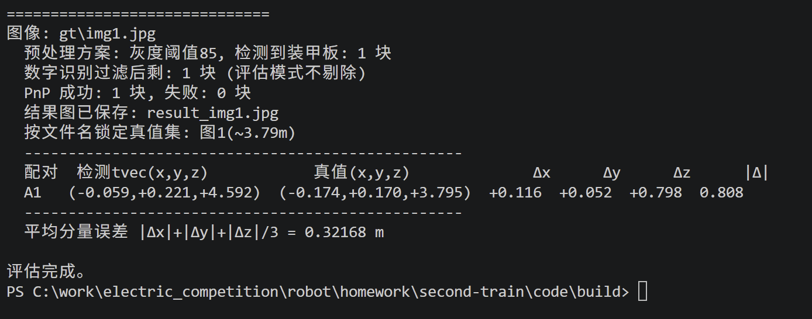
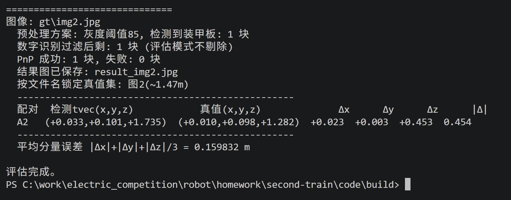
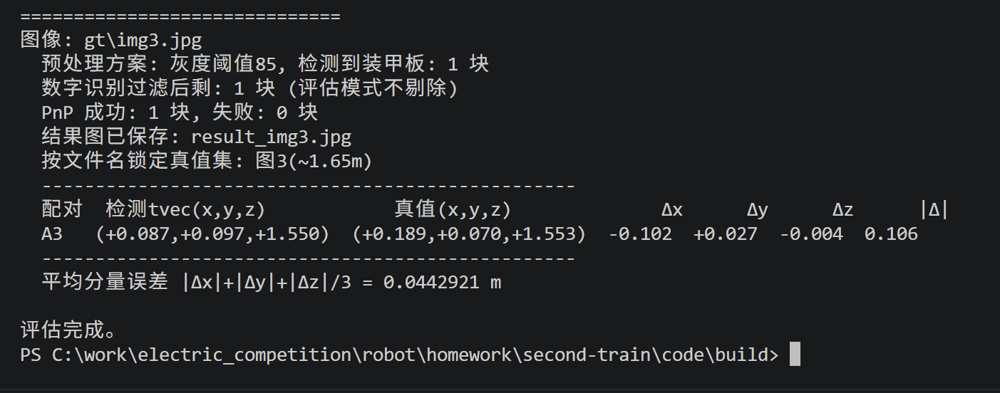
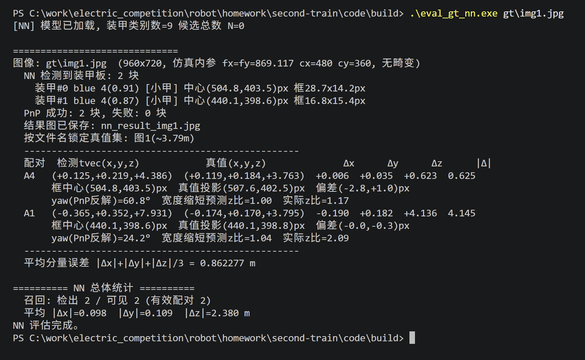
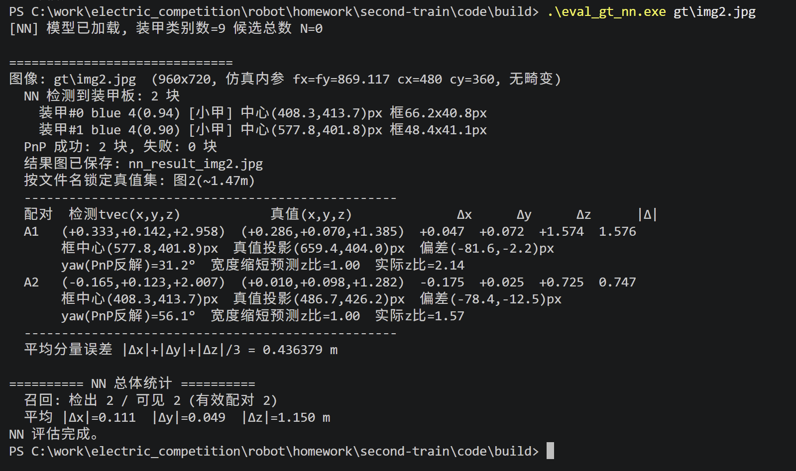
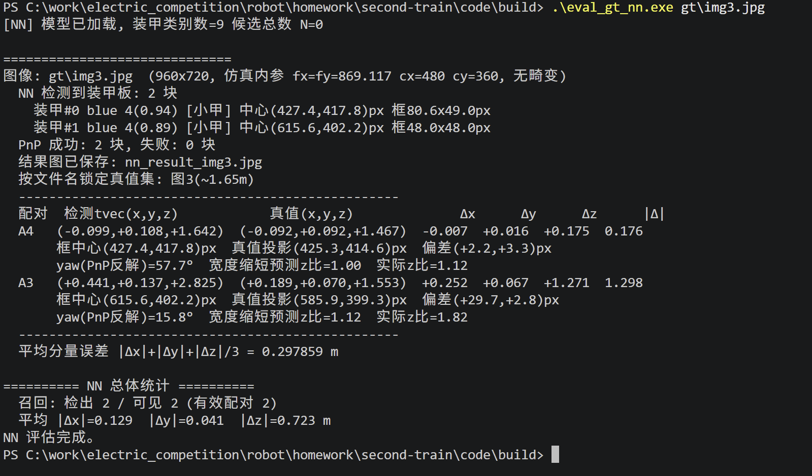

一．
传统视觉解算原理：不用放缩补边，直接在原始分辨率上进行计算。先通过轮廓，矩形的各边平行性质，还原几何，是否细长竖直，颜色对不对找到灯条，对灯条进行两两配对，保证左灯条在左，右灯条在右，且中间距离符合小/大装甲。再进行数字的识别，根据透视的原理把数字摆正，置信度不足的扔掉后取最大概率为预测数字。然后进行PnP解算，通过IPPE（专门处理在同一平面上的点）内部计算出两个解（两个解关于装甲板镜面对称），把计算出来的两组解投回原图中，哪一个离角点更近，哪一个就是正面的解（误差小的那一个），返回这个值。
神经网路方法解算原理：拿到原始图之后会先进行图片改变，变成神经网络可以识别的图片，有缩放补边，颜色空间BGR → RGB，归一化（255压缩到1），NCHW重排。然后给这个图像喂给模型，一次前向吐出 [1, 21, 6300]，把像素变为候选框都是负责识别什么的，角点分布在哪里。再开始解析，对颜色，数字进行评估（此时未涉及大小装甲判定），取可能性最大，且概率大于一定值的为装甲颜色数字的判定值。之后，将角点还原并将顺序变为与PnP相同的顺序，合成灯条，判断大小装甲，留下最准的框作为最终的框（同一块板可能被多个锚框命中，按重叠度去重，只留最准的一个），到此神经网络的部分结束。开始PnP！根据刚刚得到的角点坐标，再加装甲的真实尺寸，相机内参，根据相机小孔模型，解出来装甲板中心相对于相机的位置（2D反推3D）。最后的最后，算出距离，搞定！
二．
项目结构
common/：共用模块。armor_types.h 定义两套检测器的统一数据结构；camera_config.h 存放相机内参、畸变系数、装甲真实尺寸与关键点顺序；pnp_solver.h/.cpp 实现 IPPE 位姿解算；main.cpp 是视频主程序，用 #define USE_NN 切换两种检测器。
traditional/（传统方法）：armor_detector 用颜色阈值找灯条再两两配对；number_classifier 用透视变换把数字摆正后交给 MLP 识别；tools/eval_gt.cpp 为传统误差评估程序。
neural/（神经网络方法）：neural_detector 用 YOLOv8n-Pose 一次前向直接输出四关键点、颜色与装甲类别；tools/test_nn.cpp 做端到端验证，tools/eval_gt_nn.cpp 做 NN 误差评估。
models/：mlp.onnx（数字识别，两类共用）、Infantry-v8n-*.onnx（NN 检测，含 fp16 原版与 fp32 转换版）、label.txt（两类共用的 9 类标签：数字 1~5 装甲 + outpost 前哨站 + guard 哨兵 + base 基地 + negative 负样本）。
tools/：离线 Python 诊断脚本，不参与构建。
2.依赖配置
工具链：MSYS2 + UCRT64（MinGW-w64，GCC 13.x）。注意 onnxruntime 仅 UCRT64 提供安装包，必须用 UCRT64 终端。
依赖库：OpenCV5（find_package 引入）、ONNX Runtime（CMake 中设为可选，仅 NN/数字模块使用）、Qt（OpenCV 的 imshow 窗口依赖 platforms/qwindows.dll）。
DLL 坑：Windows 加载 DLL 时 System32 优先于 PATH，若系统被其他软件装了旧版 onnxruntime.dll（实测 1.17.1）会截胡正确版本；本工程 CMake 已加 POST_BUILD 步骤，构建后自动把匹配版本的 onnxruntime DLL 拷到各 exe 旁边（exe 目录优先级最高）。
三．
1.数据

相对误差：0.210277

相对误差：0.353354

相对误差：0.002576
三张图片都是仿真相机拍摄出来的，没有误差。对于PnP处理，AI给了我一些新的想法，在检测阶段不做畸变，把畸变系数直接传给solvePnP，由PnP内部直接处理畸变，AI说这样可以省一步、且不重采样图像，而且灯条边缘不会被插值糊掉（我感觉说的挺对的）。

相对误差：0.165559（A4）   1.089855（A1）

相对误差：1.136462（A1）  0.565523（A2）

相对误差：0.119291（A4）    0.818415（A3）
传统方法优势与局限性：整体误差还是比较大的，误差小的也是刚好蒙的比较准确。装甲板容易漏掉，比如，图二中其实有两块装甲板，但是传统方法只能识别出来一个。对于颜色的判定较弱，开始识别图片时就因为图片背景过亮，与之前视频的背景颜色差异大，环境发生了一定的改变而重新调整的代码。但是识别是速度很快。
神经网络方法的优势与局限性：相对于传统方法，其对装甲板数量的识别是极为准确的，并且在对相对正的位置的装甲板的识别较为准确，误差基本在10%几，仅有一个距离较近的相对误差较大。但是其识别的速度较慢，在变运行变显现视频的时候，明显可以感受到视频的 速度变慢了，每一帧画面都存在，都识别，让这个的整体速度下降了不少。
2.遇到问题
1. 开始不是很理解PnP与检测角点的关系PnP = 已知装甲板真实尺寸 + 图像角点 + 相机参数 → 反推位置。把开始通过亮度+轮廓+旋转矩形得到的角点位置喂给PnP，PnP就能反推出这个装甲板在现实中相对于相机的真实位置。
2. 在传统视觉方法的误差分析中，我计算出结果后，我去询问AI对不对，他说我的图二处理的有问题，发现了之前的代码有一些问题，是通过三维坐标去猜，而且容易识别到背面的装甲板。现在改成了，只和正面可见装甲配对 + 用 x/y 配对。
3.问题好像挺多的，不太记得了......
题外话：
传统方法与神经网络方法比拼的是角点的定位准不准，最终决定距离计算准不准的是PnP的准确度，如果PnP准了，误差可能会缩小很多，但是PnP就这样，精度不可变，所以需要在其他方面去解决，提升角点质量还是比较难的，我让AI给我想了几个方法，有几个我认为很可行：
1.时序滤波 
卡尔曼滤波平滑z：单帧z噪声大，用KF跟踪 (x,y,z,vx,vy,vz) 平滑抖动、预测下一帧。进行运动学约束、维持目标track id多帧投票、异常值剔除。
亚像素 refine
NN 回归的角点是整数量级，可在检测框周围用 cornerSubPix/模板匹配推到亚像素，压住斜视角下四边形的轻微形变。
3.算法与鲁棒（求解器层面）
IPPE 初值 + 迭代精修：SOLVEPNP_IPPE 给平面 4 点两解取优，可拿它当初值再用 SOLVEPNP_ITERATIVE（LM）迭代降重投影误差。
（不知道这些方法可不可行）
注：本次作业AI使用为work Buddy，之前所用的Qclaw由于马上停止使用没有继续使用。代码部分是work Buddy写的，我全部浏览过，清楚每一步都在干什么，但是不能独立全部写出。
